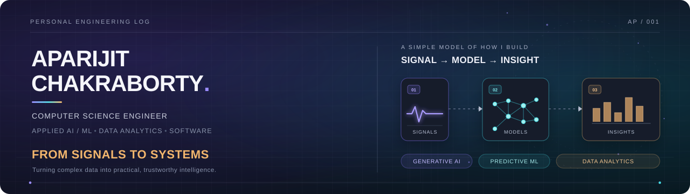

  
    

  
  
  

  

    <strong>Computer Science Engineer (B.Tech '26 @ SRMIST, CGPA: 8.1/10)</strong>  ·  Multimodal AI / ML  ·  Geospatial CV  ·  Data Analytics 
    📍 Bengaluru, Karnataka, India
  

---

## `01` / About Me

I am a Computer Science Engineer building production-minded systems at the intersection of **multimodal generative AI, geospatial computer vision, high-dimensional machine learning, and automated analytics**. I focus on taking complex physical signals and messy real-world datasets through the full engineering lifecycle — from deterministic preprocessing and physics-calibrated modeling to rigorous validation gates and interactive web deployment.

- 🎯 **Flagship Multimodal & Geospatial Builds:**
  - **CardioScribe v2:** A 12-lead ECG-to-clinical report generation pipeline bridging a frozen ECG-pretrained Transformer encoder (**0.9307 macro-AUROC** on PTB-XL) to **Llama-3-8B (4-bit NF4 QLoRA)** via a 32-query **Q-Former**, paired with a bit-exact browser signal-processing engine.
  - **Renewable-Site-Vision-AI:** An end-to-end `L0–L4` renewable energy site-selection architecture combining 7-class aerial parcel segmentation (**0.8721 mIoU** at **0.05s/1024px**), **CorrDiff** micro-climate downscaling, automated layout blueprints, and the **TERRA** interactive assistant (**1.8s** e2e latency).
- 💼 **Industry Experience:** Former **Data Science Intern at Corizo Edutech Pvt. Ltd.** (Dec 2025 – Feb 2026), engineering pass/fail semiconductor yield classifiers across 1,567 entities and 591 sensor signals alongside pure NumPy statistical pipelines on NHANES health data.
- 🔬 **Peer-Reviewed Research:** Published author in **Springer Nature** (*Dual-Stream Anxiety Detection via LSTM & CNN*) and **IEEE** (*Efficient Cloud Resource Allocation*).
- 🏆 **National Recognition:** Secured **Top 25 All India Rank (AIR)** at the **eLSI Hackathon 2024** (e-Yantra, IIT Bombay).

---

## `02` / Tech Stack & Engineering Toolkit

| Domain | Technologies & Frameworks |
| :--- | :--- |
| **Languages & Web** |       |
| **Generative AI & Multimodal** |     |
| **Machine Learning & CV** |     |
| **Signal, Data & BI** |       |

---

## `03` / Featured Builds

<table>
  <tr>
    <td width="50%" valign="top">
      <h3>🫀 CardioScribe v2</h3>
      PyTorch · Transformer Encoder · Q-Former · Llama-3-8B QLoRA · SciPy
      
Multimodal signal-language pipeline translating raw 10-second, 12-lead ECG waveforms (500 Hz) into structured, evidence-grounded clinical reports on a single 24GB GPU. Clears a <strong>0.9307 macro-AUROC</strong> encoder gate on PTB-XL 1.0.3 and ships with a bit-exact browser signal-processing engine.

      <a href="https://github.com/aparijit05072004/Cardio_Scribe">Explore repository ↗</a>  ·  <a href="https://aparijit05072004.github.io/Cardio_Scribe/">Live Demo ↗</a>
    </td>
    <td width="50%" valign="top">
      <h3>🌍 Renewable-Site-Vision-AI</h3>
      PyTorch · Semantic Segmentation · CorrDiff · Geospatial AI · TERRA
      
End-to-end L0–L4 spatial suitability & micro-climate pipeline for utility-scale solar and wind site selection. Features <strong>0.8721 mIoU</strong> 7-class parcel segmentation (0.05s/1024px), physics-calibrated CorrDiff hub-wind downscaling, automated layout blueprints, and a 1.8s e2e validated dashboard.

      <a href="https://github.com/aparijit05072004/Renewable-Site-Vision-AI">Explore repository ↗</a>
    </td>
  </tr>
  <tr>
    <td width="50%" valign="top">
      <h3>📈 India CPI Inflation Analytics</h3>
      Python · Pandas · Advanced Excel · Matplotlib · Automated CI
      
Deterministic Python pipeline cleaning 10 years of Government of India CPI extracts (2013–2023) into 375 validated rows, powering a 14-sheet workbook and executive dashboard (6 KPIs, 21 charts) backed by <strong>856 automated CI checks</strong>.

      <a href="https://github.com/aparijit05072004/India-CPI-Inflation">Explore repository ↗</a>
    </td>
    <td width="50%" valign="top">
      <h3>🧪 Physics-Informed GP Biogas Yield</h3>
      Python · Physics-Informed Gaussian Process · Genetic Algorithm
      
Hybrid probabilistic model embedding biochemical and thermodynamic laws directly into the covariance kernel to predict and optimize biogas yield from organic waste, achieving <strong>R² > 0.99</strong> under extreme data scarcity.

      <a href="https://github.com/adityaroy3010/Physics-Informed-GPR-Biogas-Yield-Prediction-From-Organic-Waste">Explore repository ↗</a>
    </td>
  </tr>
  <tr>
    <td width="50%" valign="top">
      <h3>🧠 Dual-Stream Anxiety Detection</h3>
      Python · LSTM · CNN · Acoustic Speech & Sentiment NLP
      
Multimodal deep learning system fusing LSTM-based acoustic speech analysis with CNN-driven textual sentiment classification for automated anxiety detection. Peer-reviewed and published in <strong>Springer Nature</strong>.

      <a href="https://github.com/aparijit05072004/Anxiety-detectionn-using-speech-analysis">Explore repository ↗</a>
    </td>
    <td width="50%" valign="top">
      <h3>🌫️ Global Multicity AQI Regression</h3>
      Python · Scikit-Learn · Pandas · Seaborn · Time-Series ML
      
End-to-end hourly AQI regression across 6 cities (52.5k rows), uncovering Simpson's paradox, multicollinearity (VIF), rolling-window EPA physics, and tree-ensemble ablations (<strong>R² = 0.9984</strong>).

      <a href="https://github.com/aparijit05072004/Global-Multicity-AQI-Timeseries-Regression-Analysis-ML">Explore repository ↗</a>
    </td>
  </tr>
  <tr>
    <td width="50%" valign="top">
      <h3>📊 Retail Sales Profitability BI</h3>
      Power BI · DAX · Power Query · Star-Schema Modeling
      
End-to-end Power BI executive dashboard analyzing 4 years of multi-store retail operations (5,000 transactions, 5 stores, 500+ customers) using a star-schema data model and 38+ custom DAX measures.

      <a href="https://github.com/aparijit05072004/Retail-Sales-Profitability-Dashboard-PowerBI">Explore repository ↗</a>
    </td>
    <td width="50%" valign="top">
      <h3>🛒 E-Commerce Orders Analytics</h3>
      Python · Pandas · Exploratory Data Analysis · KPI Reporting
      
Structured transactional analytics pipeline evaluating order fulfillment, revenue cohorts, category margins, and customer purchasing behavior across multi-region e-commerce operations.

      <a href="https://github.com/aparijit05072004/E-Commerce-Orders">Explore repository ↗</a>
    </td>
  </tr>
</table>

---

## `04` / Publications & Recognition

- 📄 **Springer Nature** — *Dual-Stream Anxiety Detection: LSTM-Based Speech Analysis and CNN-Driven Sentiment Analysis.*
- 📄 **IEEE** — *Efficient Cloud Resource Allocation (HGD-GBCO).*
- 🏅 **IIT Bombay (e-Yantra)** — *Top 25 All India Rank (AIR), eLSI Hackathon 2024.*

---

## `05` / GitHub Activity & Stats

  
   
  

   
  BUILD WITH CURIOSITY · TEST WITH EVIDENCE · SHIP WITH PURPOSE

